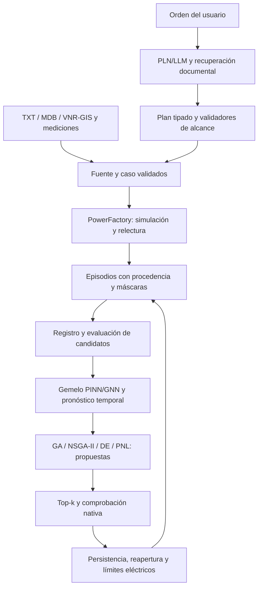

# Mejoras de IA sobre el conversor existente

Fecha: 2026-10-31. Alcance: investigación de código local, publicaciones y repositorios
primarios; propuesta de implementación. No constituye un entrenamiento nuevo, una
integración de dependencias ni aceptación eléctrica.

Plan posterior: [implementación por specs 043–049](superpowers/plans/2026-10-31-mejora-integral-ia-conversor.md).
La [verificación de publicaciones](VERIFICACION_PUBLICACIONES_IA_PF_2026-10-31.md)
contrasta los enlaces aportados con el código y registra las brechas que el plan debe cerrar.

## Decisión recomendada

Consolidar el gemelo físico existente y su evaluación antes de incorporar nuevos
modelos. La combinación propuesta es: grafo eléctrico trazable + PINN/GNN como
aproximador + pronóstico temporal + optimización mixta + asistente con herramientas
validadas. PowerFactory conserva la comprobación eléctrica final.

RNN, GNN y Transformers pertenecen al aprendizaje profundo; PINN describe cómo se
incorpora la física al aprendizaje. No son módulos independientes que deban sumarse
por cantidad. El Transformer de órdenes y un Transformer de pronóstico resuelven
problemas distintos. Aquí se distingue **PLN**, procesamiento de lenguaje natural,
de **PNL**, programación no lineal; se cubren ambas interpretaciones.

## 1. Base local comprobada

Checkout principal: `main`, HEAD `196f3369`, con cambios locales previos. Las rutas y
los artefactos siguientes se consultaron directamente; tener código o un artefacto
histórico no demuestra que el servidor esté usando ese modelo.

| Componente | Implementación actual | Aprovechamiento propuesto |
| --- | --- | --- |
| Custodia del gemelo | `digital_twin/episode.py`, `buffer.py`, `capture.py`, `integration.py`, `native_snapshot.py`; episodios y referencias nativas | Extender el contrato de observaciones y comprobar su completitud antes de aprender |
| PINN/GNN | `digital_twin/oraculo.py`: grafo, residuo nodal P/Q, conjunto de modelos, intervalos conformes, detección de dominio y promoción | Mejorar representación de equipos y validación; comparar una arquitectura PyG sin retirar el modelo actual |
| Física de respaldo | `digital_twin/flujo.py` y `ModeloRadial` | Mantenerla como referencia y respaldo; medir el aprendizaje residual frente a ella |
| RNN | `digital_twin/temporal.py`: GRU de un paso, demanda e indicador horario, referencia estacional | Pronóstico multivariante y multihorizonte con incertidumbre |
| Evolutivos | `digital_twin/evolutivo.py`: GA, NSGA-II, evolución diferencial y verificación top-k | Comparar con pymoo bajo el mismo problema y presupuesto de evaluaciones |
| Lenguaje | `asistente/transformer.py`, `interprete.py`, `ollama.py`: intención y campos, reglas y respaldo LLM | Salida con esquema, validación semántica y calibración de abstención |
| Recuperación | `asistente/indice.py`: BM25 y vectores opcionales | Fusión y reranking medidos, preservando identificadores exactos y citas |
| Ajuste de hiperparámetros | `digital_twin/hiperparametros.py` | Reutilizar la búsqueda existente con particiones selladas |

### Trabajo existente que requiere reconciliación

En `.worktrees/reentrenamiento-integral` existen `training_coordinator.py`,
`model_registry.py`, `tools/reentrenar_modelos.py` y `docs/REENTRENAMIENTO_MODELOS.md`.
Esos cuatro archivos **no existen en el checkout principal** consultado. Deben
revisarse por archivo y contrato antes de integrar; un merge completo puede pisar
las actualizaciones posteriores de fuente, calibración y web.

En ese worktree se releyeron los artefactos históricos de entrenamiento:

- GRU `20261025-234945-s23`: el informe registra `promovido: true`.
- PINN `20261025-235411-dd63`: registra `promovido: false` por regresión en dos familias.

Esto acredita el contenido de esos informes, no la activación actual en la web. La
spec 027 conserva pendientes de órdenes reales, escenarios y aceptación nativa.
La spec 024 cumplida tampoco certifica cualquier nuevo peso o ampliación del modelo.

## 2. Correcciones previas de mayor valor

Hallazgos por inspección estática; no se ejecutó una reproducción de entrenamiento
ni se modificaron los módulos durante esta investigación.

1. **Normalización temporal:** `GemeloGRU.entrenar`, en `temporal.py`, obtiene
   `self.escala` de toda la serie recibida antes de separar entrenamiento y validación
   interna. Calcularla solo con entrenamiento y persistirla evita que la amplitud de
   validación influya en la preparación del modelo. El test externo debe quedar aparte.
2. **Calibración de intervalos:** `oraculo.entrenar` usa validación para parada temprana
   y después para `calibrar_conforme`; además contempla recurrir a entrenamiento si
   falta validación. Separar entrenamiento, selección, calibración y prueba. Reportar
   cobertura por familia y ventana temporal; un cuantil nominal no prueba cobertura
   bajo cambio de topología o distribución.
3. **Métricas ausentes en top-k:** en `evolutivo.verificar_top_k`, una tensión mínima
   ausente puede producir `dv = 0`; pérdidas ausentes o una predicción cero pueden
   producir `dp = 0`. Ese ayudante puede marcar la alternativa como verificada si hay
   convergencia. Exigir métricas finitas y completas, límites, unidades y contexto
   nativo. Revisar la cadena completa con `digital_twin/evaluacion.py`, sin equiparar
   esta revisión estática con la demostración de una aceptación errónea en producción.
4. **Promoción por grupos:** el principal compara error agregado, residuo y casos
   dorados; el trabajo de reentrenamiento contiene controles adicionales por familia.
   Conservarlos al reconciliar las ramas: una buena media no justifica una regresión
   crítica en otra red.
5. **Esquema LLM:** `asistente/ollama.py` solicita `format: 'json'`. Pasar el esquema
   de la tarea al campo `format`, admitido por Ollama, restringe la estructura. Después
   deben comprobarse entidades, alcance, unidades y precondiciones; JSON válido no
   demuestra que la orden sea correcta.

La prioridad es corregir y probar estos puntos antes de buscar mejoras de puntuación
con arquitecturas mayores.

## 3. Repositorios seleccionados y uso concreto

Se revisaron páginas oficiales y metadatos públicos de GitHub. La selección responde
al encaje técnico; no se utilizaron estrellas como evidencia de calidad ni se probaron
instalaciones nuevas. Las licencias son las observadas, no un dictamen jurídico.

| Recurso primario | Qué tomar | Integración propuesta | Prioridad |
| --- | --- | --- | --- |
| [PyTorch Geometric](https://github.com/pyg-team/pytorch_geometric), MIT | Operadores de mensajes y grafos heterogéneos | Adaptador de los episodios actuales; comparar con la GNN propia | Alta |
| [PowerFlowNet](https://github.com/StavrosOrf/PoweFlowNet), MIT | Arquitectura específica de aproximación de flujo | Candidato experimental con el mismo dataset y puertas del oráculo | Alta como comparación |
| [NeuralForecast](https://github.com/Nixtla/neuralforecast), Apache-2.0 | GRU, NHITS, TFT y PatchTST, entre otros modelos | Adaptador de series con covariables y evaluación temporal común | Alta |
| [pymoo](https://github.com/anyoptimization/pymoo), Apache-2.0 | Optimizadores mono/multiobjetivo y variables mixtas | Comparador de GA/NSGA-II/DE propios para bancos, conductores y maniobras | Alta |
| [Sentence Transformers](https://github.com/huggingface/sentence-transformers), Apache-2.0 | Embeddings y CrossEncoder | Segunda etapa de ordenación de documentos tras recuperación híbrida | Alta |
| [PEFT](https://github.com/huggingface/peft), Apache-2.0 | Adaptación LoRA y modelos cuantizados | Reutilizar el pipeline de adaptación existente del worktree | Media, tras evaluar datos |
| [Pyomo](https://github.com/Pyomo/pyomo) y [Ipopt](https://github.com/coin-or/Ipopt) | Modelado algebraico y resolución no lineal continua | Referencia numérica y ajuste continuo dentro de decisiones discretas | Media |
| [DeepXDE](https://github.com/lululxvi/deepxde), LGPL-2.1 | PINN para problemas directos e inversos ODE/PDE | Experimento acotado de identificación de parámetros, si hay observabilidad | Selectiva |
| [PhysicsNeMo](https://github.com/NVIDIA/physicsnemo), Apache-2.0 | Infraestructura de aprendizaje físico | Evaluar en un entorno de investigación separado si la escala lo exige | Posterior |
| [Grid2Op](https://github.com/Grid2op/grid2op), MPL-2.0 | Entorno de decisiones secuenciales de operación | Investigación futura de políticas; requiere adaptar acciones y validación | Posterior |
| [PowerGraph](https://github.com/PowerGraph-Datasets) | Datos públicos y protocolos de comparación de GNN | Pruebas externas de generalización; revisar licencia de cada dataset | Complementaria |

Pyomo declara licencia BSD y contiene avisos de terceros; Ipopt declara EPL-2.0.
La API de GitHub devolvió para pymoo el nombre `the-dual-space/pymoo` al consultar
el enlace de `anyoptimization`; conservar la procedencia y comprobar el tag de la
distribución elegida al hacer una integración.

[TimeXer](https://github.com/thuml/TimeXer) es una referencia pertinente para
Transformers con variables exógenas. En la consulta no se detectó una licencia en
sus metadatos; revisar el permiso antes de incorporar su código. Para un primer
experimento, NeuralForecast ofrece alternativas con una licencia identificada.

### Qué no se puede trasladar directamente

PowerFlowNet y los benchmarks públicos no demuestran precisión en las redes de esta
entrega. Deben contrastarse con fases, controles, transformadores y casos propios.
Grid2Op no constituye una integración lista para PowerFactory. DeepXDE y PhysicsNeMo
son herramientas de aprendizaje físico, pero no reemplazan automáticamente un modelo
de flujo AC ni reconstruyen datos eléctricos faltantes.

## 4. Diseño recomendado por familia

### Gemelo digital y PINN/GNN

- Conservar el búfer inmutable y el contexto de fuente, proyecto, caso, año y acción.
- Incorporar al contrato, donde existan, consignas y medidas efectivas P/Q, generación,
  bancos y escalones, taps, estados de conexión y modelo de carga. Registrar también
  opciones relevantes del cálculo nativo, como adaptación del modelo de carga.
- Distinguir máscaras de medición de valores cero. Un dato faltante no es una medida.
- Comparar un grafo heterogéneo de barras, líneas, transformadores, cargas, bancos y
  generadores con la representación actual. Incluir atributos de rama y tipo de equipo.
- Mantener la corrección residual sobre física como candidato. Añadir objetivos
  auxiliares de ángulo, pérdidas y cargabilidad solo cuando haya etiquetas nativas.
- Para redes desequilibradas, modelar explícitamente las fases o declarar el alcance
  equilibrado y derivar lo restante al motor; no inferir aceptación trifásica desde
  un aproximador equilibrado.
- Entrenar con escenarios informativos y diversidad topológica: variaciones de
  demanda, central, bancos y contingencias autorizadas. Los escenarios con violaciones
  pero resultados físicos válidos sirven para aprender inviabilidad; los resultados
  ausentes o sin convergencia no se convierten en etiquetas de tensión inventadas.
- Medir abstención, error y cobertura por sistema, topología, tamaño, generación y
  régimen operativo. Elegir el siguiente escenario por incertidumbre y diversidad
  es una extensión de aprendizaje activo que debe compararse con el muestreo actual.

Una mejora de esta representación requiere versionar el grafo y revisar la
compatibilidad de los pesos existentes; no basta con añadir columnas al entrenamiento.

### RNN y Transformers temporales

Primero comparar estacional diario/semanal, GRU actual y NHITS; después TFT y PatchTST.
TFT resulta pertinente si hay covariables conocidas del horizonte. No debe asumirse
que cualquier modelo acepta los mismos tipos de covariables: el adaptador declarará
cuáles son históricas, conocidas a futuro o estáticas.

Objetivos: P y Q, incertidumbre y horizontes de 1, 4 y 96 intervalos como propuesta
experimental para series de 15 minutos. Confirmar cadencia, zona horaria y cobertura
antes de fijar esos horizontes. Incorporar calendario, estados operativos y generación
solo si estaban disponibles en el instante de emisión del pronóstico.

Aplicar evaluación de origen móvil con normalización ajustada exclusivamente en
entrenamiento y sin ventanas que filtren objetivos futuros. Reconciliar los pronósticos
de alimentadores y SET considerando generación y pérdidas. No imponer una suma de
demandas sin distinguir generación, pérdidas y frontera de medición.

Medir MAE/RMSE por horizonte, error de máximas y, para intervalos, cobertura y pérdida
de cuantiles. Comparar diferencias pareadas por día/semana y sistema; no contar todos
los puntos correlacionados como observaciones independientes.

### LLM, PLN y Transformers de órdenes

La mejora inmediata es un asistente restringido por contratos de herramientas:
clasificación y campos → esquema → resolución de entidades → plan → validadores
actuales → cola nativa. Los nombres de alimentador y SED se resuelven en la fuente
activa; no se completan por semejanza cuando hay ambigüedad.

Para recuperación, conservar BM25 para códigos y combinarlo con candidatos semánticos;
después aplicar un CrossEncoder. Evaluar citas correctas, recuperación de identificadores
y abstención, además de Recall/MRR/nDCG. El procedimiento de recuperar y reordenar está
documentado por [Sentence Transformers](https://www.sbert.net/examples/sentence_transformer/applications/retrieve_rerank/README.html).

Ollama permite [esquemas JSON en sus salidas](https://docs.ollama.com/capabilities/structured-outputs).
Reutilizar el esquema del plan y hacer validaciones semánticas posteriores. La confianza
declarada por un LLM no es una probabilidad calibrada ni una autorización de ejecución.

PEFT/QLoRA se justifica solo después de disponer de ejemplos confirmados, desacuerdos
y órdenes difíciles. Evaluar typos en español, negaciones, tareas de consulta frente a
acciones y entidades parecidas. Mantener familias de paráfrasis y documentos completos
en una sola partición. Un mejor formato JSON no compensa más campos inventados.

La evolución de prompts, selección de variables o pesos de recuperación puede usarse
como experimento pequeño; se optimiza con validación y test sellado, sin evolucionar
las reglas de permisos, la procedencia ni la aceptación eléctrica.

### Algoritmos genéticos, evolución y PNL

Usar pymoo como comparador antes de sustituir los algoritmos propios. Mantener el
mismo problema, semilla y presupuesto de evaluaciones. Variables típicas: ubicación y
número de módulos de banco, sección/tipo de conductor, estados de maniobra y consignas
permitidas por el caso. Las potencias de los clientes fijos y la generación medida
no se vuelven variables libres para conseguir una solución artificialmente favorable.

Objetivos: CAPEX y pérdidas, y los indicadores adicionales que tenga el estudio.
Restringir tensión, cargabilidad, conectividad, radialidad cuando corresponda y
presupuesto. Precios, límites y catálogos proceden del perfil y de fuentes de empresa.

Para ajustes continuos, comparar con Pyomo/Ipopt. Una solución local no demuestra
óptimo global; una relajación continua tampoco demuestra factibilidad discreta.
Usar enumeración en ejemplos pequeños para comprobar el óptimo cuando sea viable.

Evaluar al menos las 20 semillas previstas en el diseño de reentrenamiento existente,
con tasa de factibilidad, frente de Pareto, hipervolumen con referencia común, llamadas
nativas y tiempo total. Una mejora media no compensa islas ni límites violados.

La búsqueda puede paralelizar aproximadores; las llamadas a PowerFactory respetan
su carril exclusivo. Cachear evaluaciones por fuente, topología, caso, año, periodo,
perfil, decisión y versión del modelo; no solo por el vector de decisión.

## 5. Arquitectura de integración

Los casos conservan su semántica: recalibración en «Sin proyecto» con sus restricciones
de fijas, central y bancos; diagnóstico de «Cargas nuevas» separado de las obras de
«Con proyecto». Un optimizador no debe cambiar silenciosamente esas condiciones.

## 6. Orden de implementación y aceptación

| Etapa | Cambio concreto | Criterio de salida propuesto |
| --- | --- | --- |
| P0. Consolidación | Reconciliar coordinador, registro, datasets y pruebas del worktree con el principal | Artefactos reabribles; estados por familia; ninguna capacidad anunciada solo por existir en otra rama |
| P0. Evaluación | Corregir normalización, separación de calibración y métricas ausentes | Pruebas negativas de fuga, faltantes, NaN, unidades y fuente incompatible |
| P1. Datos | Completar captura nativa y versionar el grafo | Cobertura y máscaras auditables; particiones por familia/tiempo; datos inválidos identificados |
| P1. Gemelo | Comparar GNN actual con candidato PyG/PowerFlowNet | Mejora demostrada sin regresión crítica; incertidumbre y abstención medidas |
| P1. Temporal | Comparar GRU/NHITS/TFT/PatchTST bajo el mismo protocolo | Mejora por horizonte y sistema; normalización causal; reconciliación comprobada |
| P1. Asistente | Esquemas, recuperación híbrida y reranking | Entidades y citas correctas; abstención; ninguna omisión de precondiciones |
| P2. Optimización | Comparar implementación propia, pymoo y referencia PNL | Factibilidad y Pareto con presupuesto comparable; mejores alternativas verificadas nativamente |
| P2. Adaptación LLM | Entrenamiento LoRA/QLoRA si los datos justifican el coste | Mejora en órdenes reales y campos, sin degradar permisos, citas ni abstención |

Mantener los umbrales normativos del perfil. En el oráculo actual, `Puertas` define
MAE de tensión de 0,005 p.u., residuo máximo 0,05 y tolerancia de dorados 1,05. Son
puertas de ese modelo, no sustitutos de límites eléctricos ni objetivos universales
para todas las ampliaciones. Definir antes del experimento los criterios por grupo
y los intervalos de comparación; no elegirlos después de ver el test.

Cada ampliación funcional deberá entrar por spec, plan y tareas conforme al proceso
del repositorio. Relacionar el trabajo con 024, 026, 027 y los contratos de fuente y
caso; las specs cumplidas no deben crecer con requisitos nuevos. Esta investigación
no reserva un número ni declara aprobada una implementación.

## 7. Encaje en el equipo actual

Se consultaron metadatos del entorno: Python 3.12 requerido por PowerFactory; GPU
RTX 4060 Laptop con aproximadamente 8 GiB. Hay distribuciones de torch, transformers,
PEFT, TRL, bitsandbytes, sentence-transformers y Optuna. No se encontraron PyG,
NeuralForecast, pymoo ni Pyomo instalados por sus nombres de distribución.

Estos metadatos no prueban compatibilidad binaria, VRAM disponible ni entrenamiento
correcto. Empezar por modelos pequeños y lotes de grafos acotados. Evaluar un adaptador
de 3–4B cuantizado como experimento condicionado a memoria; no prometer que cabe sin
una prueba de carga y entrenamiento. Coordinar Ollama y entrenamiento para evitar
competencia por GPU.

Mantener el entorno nativo Python 3.12 estable. Evaluar nuevas combinaciones en un
entorno de aprendizaje aislado, fijando paquetes, revisión de modelo y CUDA tras
probarlas. PhysicsNeMo y sus variantes aceleradas requieren revisar su plataforma y
dependencias específicas; no imponerlas al conversor para convertir una red.

## 8. Fundamento académico consultado

Las siguientes fuentes sostienen métodos o límites de las propuestas. Sus resultados
experimentales no son resultados del conversor ni aceptación de una red de la empresa.

1. **Tesis de maestría.** Zhang, S. (2024). *Physics-Informed Machine Learning with
   Applications to Power Systems*. University of California, Riverside.
   [Registro y texto](https://escholarship.org/uc/item/4g839337).
   Aporta contexto de optimización asistida y aprendizaje físico. Sus experimentos
   dinámicos no validan directamente el flujo estático de este conversor.
2. **Tesis doctoral.** Stiasny, J. B. (2023). *Physics-Informed Neural Networks for
   Power System Dynamics*. Technical University of Denmark.
   [Registro](https://orbit.dtu.dk/en/publications/physics-informed-neural-networks-for-power-system-dynamics/).
   Su análisis de escalabilidad y enfoque híbrido apoya experimentar por componentes;
   su ámbito dinámico requiere datos y estados distintos a series de carga de 15 minutos.
3. **Artículo de revista.** Lin, N., Orfanoudakis, S., Ordonez Cardenas, N., Giraldo,
   J. S., y Vergara, P. P. (2024). PowerFlowNet: Power flow approximation using message
   passing Graph Neural Networks. *International Journal of Electrical Power & Energy
   Systems, 160*, 110112.
   [DOI](https://doi.org/10.1016/j.ijepes.2024.110112),
   [texto publicado en TNO](https://publications.tno.nl/publication/34643410/FBJD74Um/lin-2024-powerflownet.pdf).
4. **Artículo de revista.** Blank, J., y Deb, K. (2020). pymoo: Multi-objective
   Optimization in Python. *IEEE Access, 8*, 89497–89509.
   [DOI](https://doi.org/10.1109/ACCESS.2020.2990567),
   [entrada en el índice DOAJ](https://doaj.org/article/ecf4c4ba21044cd18dbacc88819ea5f3).
5. **Artículo de revista.** Lim, B., Arik, S. Ö., Loeff, N., y Pfister, T. (2021).
   Temporal Fusion Transformers for interpretable multi-horizon time series
   forecasting. *International Journal of Forecasting, 37*(4), 1748–1764.
   [DOI](https://doi.org/10.1016/j.ijforecast.2021.03.012).
6. **Artículo fundacional.** Raissi, M., Perdikaris, P., y Karniadakis, G. E. (2019).
   Physics-informed neural networks: A deep learning framework for solving forward
   and inverse problems involving nonlinear partial differential equations.
   *Journal of Computational Physics, 378*, 686–707.
   [DOI](https://doi.org/10.1016/j.jcp.2018.10.045).

## 9. Evidencia y límites de esta revisión

- Lectura del código principal y del worktree de reentrenamiento; consulta de sus
  informes históricos; no se verificó activación de esos pesos en el servidor.
- Consulta de repositorios, documentación oficial, licencias y textos académicos.
- Se conservaron metadatos y revisiones públicas en
  `output/investigacion_ia_conversor_20261031/`. Son una foto de consulta, no versiones
  seleccionadas ni paquetes probados para instalación.
- No se ejecutaron nuevos entrenamientos, benchmarks comparativos ni maniobras
  nativas. No se atribuye a estas propuestas una mejora porcentual todavía no medida.
- La recomendación prioritaria es resolver consolidación, calidad y evaluación,
  después comparar arquitecturas y optimizadores con evidencia por familia.

### Revisiones públicas consultadas

Estos commits fijan la consulta del código; no son versiones aprobadas para instalar.

| Repositorio | Revisión consultada | Fecha UTC |
| --- | --- | --- |
| pyg-team/pytorch_geometric | [ea2c5f62d54c](https://github.com/pyg-team/pytorch_geometric/commit/ea2c5f62d54c8b414dd3ea7139814a7c1ef83182) | 2026-10-21T23:52:59Z |
| StavrosOrf/PoweFlowNet | [1ebf73ba9605](https://github.com/StavrosOrf/PoweFlowNet/commit/1ebf73ba9605427fccb273a6a703b059d800dedc) | 2024-08-25T06:21:33Z |
| Nixtla/neuralforecast | [cf7449383ac5](https://github.com/Nixtla/neuralforecast/commit/cf7449383ac5ff6041ec35cbd97b84c23dd559a0) | 2026-10-27T14:47:12Z |
| anyoptimization/pymoo | [23110c155aa8](https://github.com/the-dual-space/pymoo/commit/23110c155aa8f31b5f1b86928227fb3931ba7f00) | 2026-07-07T01:34:48Z |
| huggingface/peft | [03412afcf1e9](https://github.com/huggingface/peft/commit/03412afcf1e96f74a014e467a313b22baeb74498) | 2026-10-30T05:21:13Z |
| lululxvi/deepxde | [99b6620386d1](https://github.com/lululxvi/deepxde/commit/99b6620386d18cefb1549dddb7b7fe468cfad607) | 2026-08-18T01:17:55Z |
