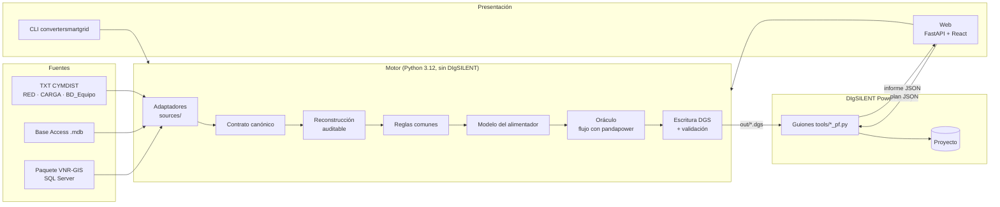
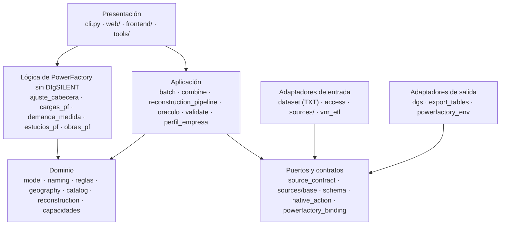
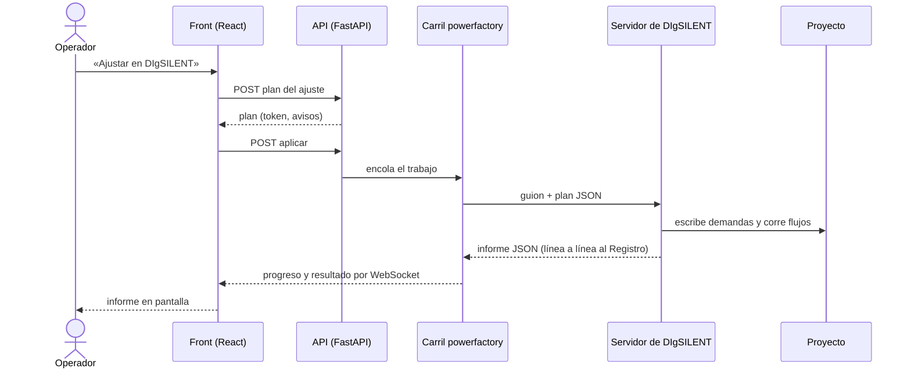
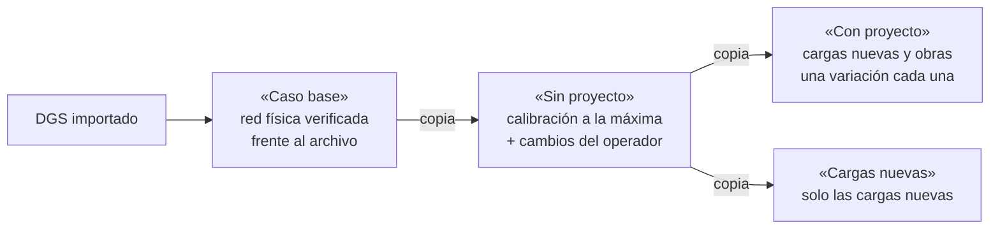
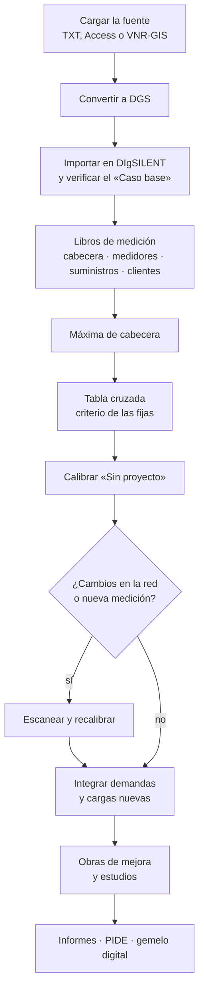
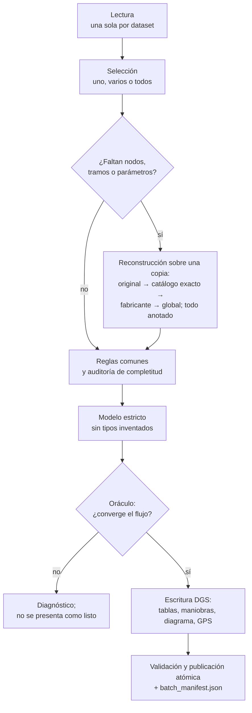
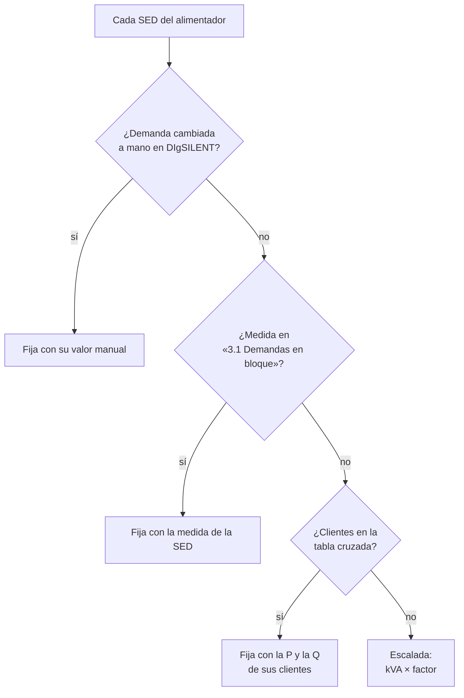
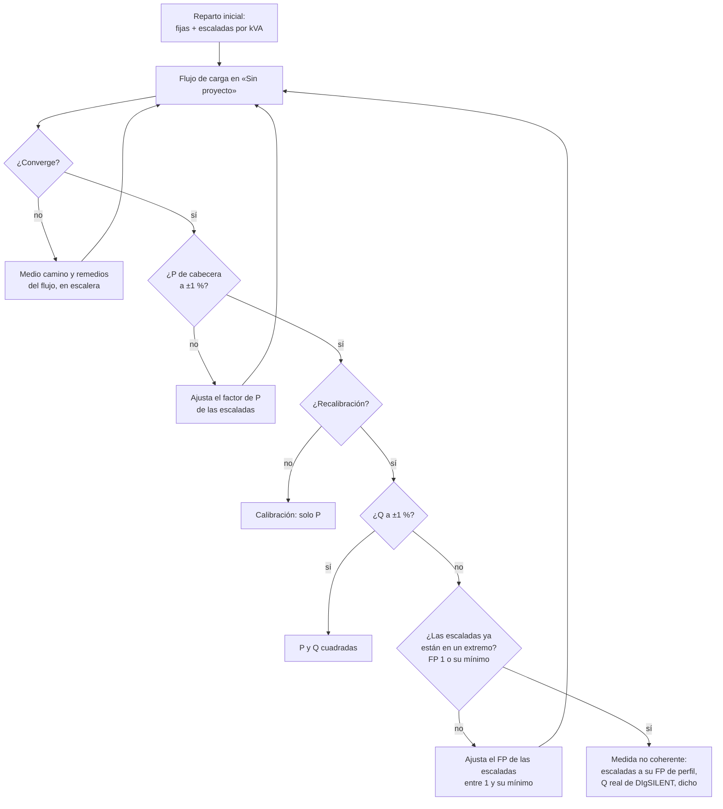
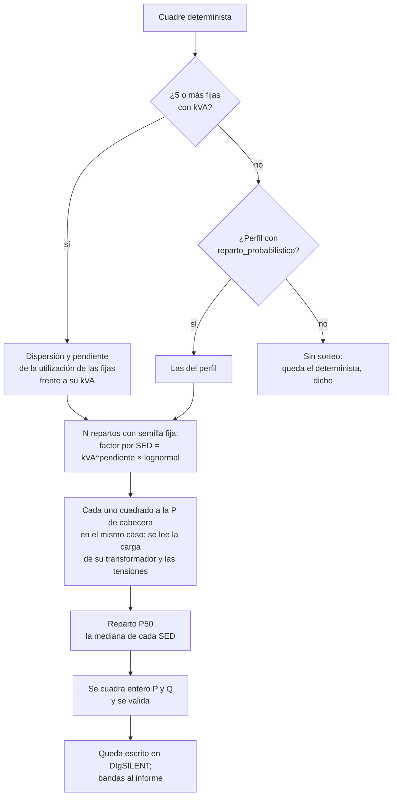
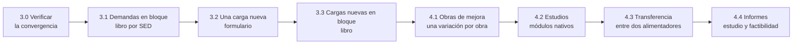

# Manual de uso del ConverterSmartGrid

**De la red exportada por CYMDIST, Access o VNR-GIS a un proyecto calibrado y estudiado en
DIgSILENT PowerFactory**

Edición del 31 de octubre de 2026. Este libro explica qué hace el conversor, cómo está hecho y
cómo se trabaja con él, paso a paso. Las órdenes exactas, sus opciones y los códigos de salida de
cada herramienta están en el anexo [Manual de comandos](MANUAL_COMANDOS.md); los requisitos de
cada función, en [specs/](../specs/README.md); los principios que no se negocian, en la
[constitución](constitution.md).

---

## Índice

- [Parte I · Conocer el conversor](#parte-i--conocer-el-conversor)
  - [1. Qué es y para qué sirve](#1-qué-es-y-para-qué-sirve)
  - [2. Conceptos que usa todo el libro](#2-conceptos-que-usa-todo-el-libro)
  - [3. Principios de trabajo](#3-principios-de-trabajo)
- [Parte II · Arquitectura](#parte-ii--arquitectura)
  - [4. Vista general](#4-vista-general)
  - [5. Capas y módulos](#5-capas-y-módulos)
  - [6. La web: trabajos, carriles y espacio de trabajo](#6-la-web-trabajos-carriles-y-espacio-de-trabajo)
  - [7. Los casos de estudio en DIgSILENT](#7-los-casos-de-estudio-en-digsilent)
  - [8. Configuración por empresa](#8-configuración-por-empresa)
- [Parte III · Flujos de trabajo](#parte-iii--flujos-de-trabajo)
  - [9. El recorrido completo](#9-el-recorrido-completo)
  - [10. Flujo de conversión](#10-flujo-de-conversión)
  - [11. Flujo de calibración y recalibración](#11-flujo-de-calibración-y-recalibración)
  - [12. Flujo de integración, obras y estudios](#12-flujo-de-integración-obras-y-estudios)
- [Parte IV · Procedimientos](#parte-iv--procedimientos)
  - [P1. Preparar el equipo](#p1-preparar-el-equipo)
  - [P2. Abrir la web y crear un espacio de trabajo](#p2-abrir-la-web-y-crear-un-espacio-de-trabajo)
  - [P3. Convertir alimentadores a DGS](#p3-convertir-alimentadores-a-dgs)
  - [P4. Importar y verificar el «Caso base»](#p4-importar-y-verificar-el-caso-base)
  - [P5. Calibrar a la máxima de cabecera](#p5-calibrar-a-la-máxima-de-cabecera)
  - [P6. Recalibrar](#p6-recalibrar)
  - [P7. Actualizar demandas y conectar cargas nuevas](#p7-actualizar-demandas-y-conectar-cargas-nuevas)
  - [P8. Obras de mejora y estudios](#p8-obras-de-mejora-y-estudios)
  - [P9. Un sistema eléctrico entero desde el terminal](#p9-un-sistema-eléctrico-entero-desde-el-terminal)
  - [P10. Planificación PIDE y gemelo digital](#p10-planificación-pide-y-gemelo-digital)
- [Parte V · Leer los resultados](#parte-v--leer-los-resultados)
  - [13. El informe de la calibración](#13-el-informe-de-la-calibración)
  - [14. El reparto probabilístico](#14-el-reparto-probabilístico)
- [Parte VI · Problemas y soluciones](#parte-vi--problemas-y-soluciones)
- [Anexos](#anexos)
  - [A. Glosario](#a-glosario)
  - [B. Mapa de specs](#b-mapa-de-specs)
  - [C. Dónde está cada cosa](#c-dónde-está-cada-cosa)

---

# Parte I · Conocer el conversor

## 1. Qué es y para qué sirve

Una distribuidora tiene su red de media tensión en un sistema de gestión (CYMDIST, una base
Access o VNR-GIS) y necesita estudiarla en DIgSILENT PowerFactory: flujos de carga, pérdidas,
caída de tensión, confiabilidad, cargas nuevas y obras. Pasar la red a mano es lento y propenso
a errores; calibrarla a lo que mide la cabecera, más.

El conversor hace ese trabajo de punta a punta:

1. **Convierte** la red exportada en ficheros `.dgs` que PowerFactory importa: un alimentador por
   fichero o varios unidos, con sus coordenadas, su trazado y su diagrama.
2. **Importa y verifica** el proyecto en DIgSILENT («Caso base»).
3. **Calibra** las demandas a la máxima medida en la cabecera, con los clientes importantes como
   carga fija y el resto repartido de forma probabilística.
4. **Integra** demandas medidas y cargas nuevas, y **estudia** la red con los módulos nativos de
   DIgSILENT: obras de mejora, confiabilidad, capacidad y transferencias.

Sirve para cualquier distribuidora: las convenciones de cada una van en su perfil (§8). Electro
Dunas aparece en este libro solo como ejemplo real.

## 2. Conceptos que usa todo el libro

| Concepto | Qué es |
| --- | --- |
| **Fuente** | De dónde sale la red: TXT de CYMDIST (RED, CARGA, BD_Equipo), base Access (`.mdb`) o paquete VNR-GIS. Nunca se mezclan. |
| **Alimentador** | Una salida de media tensión de una subestación (SET), con sus tramos, barras y SED. |
| **SED** | Subestación de distribución: un transformador de media a baja con la carga de sus clientes. En DIgSILENT, una carga (`ElmLod`) en la barra de baja de su transformador. |
| **DGS** | Formato de intercambio de PowerFactory que escribe el conversor. |
| **Máxima de cabecera** | El registro de 15 minutos de mayor potencia del medidor de la cabecera del alimentador (o de la barra de su SET) en el periodo elegido, con su kW y su kvar. |
| **Tabla cruzada** | Los clientes importantes (libro mensual con hojas de 15 minutos) cruzados con el libro de suministros para saber en qué SED está cada uno. |
| **SED fija** | La que va a escala 1 con su demanda real: la de un cliente de la tabla cruzada o la medida en «3.1 Demandas en bloque». |
| **SED escalada** | Las demás: su demanda sale de su potencia instalada (kVA) y un factor que se ajusta hasta que la cabecera dé la máxima. |
| **Calibración / recalibración** | La primera vez que se ajusta un proyecto (solo P) y las siguientes (P y, si la medida es coherente, Q). |
| **Medida coherente** | Una Q de cabecera que la red puede dar con las escaladas entre FP 1 y su FP mínimo. |
| **P50** | El reparto de las medianas de muchos repartos posibles de las escaladas: el que queda escrito en DIgSILENT. |
| **Caso** | Caso de estudio de DIgSILENT: «Caso base», «Sin proyecto», «Con proyecto» y «Cargas nuevas». |
| **Espacio de trabajo** | Una sesión de la web con sus entradas, libros, planes, informes y calibraciones. |

## 3. Principios de trabajo

Estas reglas explican por qué el conversor se comporta como lo hace. Las completas, con cómo se
comprueba cada una, están en la [constitución](constitution.md).

- **Universal.** Nada de una empresa es un valor por defecto: su CRS, sus nombres de SED o su FP
  van en su perfil. Sin perfil no se supone nada.
- **Una fuente por vez.** TXT, Access y VNR-GIS se cargan, convierten y prueban por separado.
- **Determinista y reproducible.** El DGS es idéntico byte a byte con uno o varios procesos; el
  reparto probabilístico se repite con su semilla.
- **Nada se inventa.** Lo que se reconstruye o se deduce se anota; lo que no se puede saber se
  dice, no se rellena.
- **Reconstruir, no bloquear.** Solo una red vacía detiene una conversión.
- **Lo manual manda.** Un cambio hecho a mano en DIgSILENT es intencional: se avisa, nunca se
  pisa ni se borra.
- **Lo que no converge no es un resultado.** Un flujo que no converge se diagnostica con lo que
  dice DIgSILENT; no se presenta como listo.

---

# Parte II · Arquitectura

## 4. Vista general

El sistema tiene dos mitades que solo se hablan por ficheros: el **motor**, en Python, que no
necesita DIgSILENT, y los **guiones de PowerFactory**, que corren con el intérprete de DIgSILENT
y reciben un plan JSON y devuelven un informe JSON. La web y el CLI son dos caras del mismo motor.



## 5. Capas y módulos

El código se reparte en capas con una regla por capa. El detalle de cada fichero está en
[CODIGO_FUENTE.md](../CODIGO_FUENTE.md).



| Capa | Regla que cumple |
| --- | --- |
| Dominio | Sin FastAPI ni `powerfactory`: se prueba sin nada externo. |
| Lógica de PowerFactory | Calcula planes, repartos y resultados con datos puros; los guiones solo la ejecutan. |
| Puertos | Un único contrato para las tres fuentes y para toda acción nativa. |
| Aplicación | Una sola vía de conversión para el CLI y la web. |
| Adaptadores | Reconocen la entrada por su contenido, no por su nombre; el DGS sale igual con 1 o N procesos. |
| Presentación | La web no calcula: llama al motor o lanza un guion. |

## 6. La web: trabajos, carriles y espacio de trabajo

Nada largo corre dentro de una petición: cada acción larga es un **trabajo** con progreso,
registro y cancelación. Los trabajos van por **carriles**, cada uno en serie: el motor
(`engine`), DIgSILENT (`powerfactory`, porque PowerFactory admite un solo proceso con su motor a
la vez) y el asistente.



El **espacio de trabajo** guarda las entradas, los libros de demanda, los planes, los informes y
las calibraciones de cada proyecto. Cada carga de una fuente es una ejecución inmutable: lo
importado no se toca. El servidor de DIgSILENT mantiene el motor abierto entre órdenes y se
cierra solo a los 2 minutos sin trabajo.

## 7. Los casos de estudio en DIgSILENT



| Caso | Qué contiene | Quién lo cambia |
| --- | --- | --- |
| «Caso base» | La red tal como vino del archivo: GPS, trazado, conectividad, capacidades y tensiones verificadas. | Nadie después de verificarlo. |
| «Sin proyecto» | La red calibrada a la máxima de cabecera, con los cambios del operador (bancos, secciones, transformadores). Si chocan, gana lo manual. | La calibración y el operador. |
| «Con proyecto» | «Sin proyecto» más las cargas nuevas y las obras, cada una en su variación. | La integración y las obras. |
| «Cargas nuevas» | «Sin proyecto» más solo las cargas nuevas, para estudiarlas aparte. | La integración. |

Cada año de medición tiene sus propios casos («Sin proyecto 2025», …); no se mezclan.

## 8. Configuración por empresa

Todo lo propio de una distribuidora vive en `config/perfil_empresa.json` (local, fuera de git),
que puede heredar de un perfil de `config/perfiles/`, por ejemplo `{"perfil": "electro_dunas"}`.

| Sección / clave | Para qué |
| --- | --- |
| CRS de origen | Las coordenadas de la fuente; sin él se pide y no se supone. |
| Carpeta de DIgSILENT | Dónde están los proyectos importados. |
| `calibracion.factor_potencia_cargas` | FP de las SED escaladas (Electro Dunas: 0,98). |
| `calibracion.factor_potencia_minimo_fijas` | FP mínimo de un cliente fijo, por su banco propio. |
| `calibracion.factor_potencia_minimo_escaladas` | Hasta dónde puede bajar el FP de las escaladas al cuadrar la Q (Electro Dunas: 0,90). Sin él, su FP de perfil. |
| `calibracion.reparto_probabilistico` | `dispersion`, `pendiente` y `n` del reparto probabilístico cuando un alimentador no tiene 5 fijas para estimarlas. Sin ella, no se supone. |
| `calibracion.bancos_kvar_por_tension` | Tamaño de los bancos que se proponen por tensión. |
| `calibracion.transformadores_sed` | Fichas (NTP 370.400) para proponer transformadores nuevos. |
| `estudios` | Banda de tensión y cargabilidad máxima de los estudios y del reparto probabilístico. |
| `centrales_termicas` | Centrales en el tramo de un alimentador. |
| `planificacion` | Crecimiento de la demanda, tarifas y tasas del PIDE. |

---

# Parte III · Flujos de trabajo

## 9. El recorrido completo



## 10. Flujo de conversión



Un alimentador que falla no invalida a los demás, y nunca queda un `.dgs` a medias.

## 11. Flujo de calibración y recalibración

### 11.1 Qué es fijo y qué se escala



Las fijas van a escala 1 con su P y su Q y no se tocan. La P y la Q de un cliente de la tabla
cruzada salen de su hoja de 15 minutos con el criterio elegido en 2.3:

| Criterio | P | Q | Si falta el registro |
| --- | --- | --- | --- |
| **Coincidentes con la máxima** (por defecto) | EA × 4 del registro de la fecha y hora de la máxima de cabecera | ERI × 4 de ese mismo registro | No se toma otro: el plan no se prepara y pide el mes de los clientes de esa fecha o el otro criterio. |
| **Máximo del mes** | POT máxima del mes (EA × 4) | ERI × 4 de ese mismo registro | — |

Un cliente sin hoja de 15 minutos va con su EA/ERI del mes con los dos criterios.

### 11.2 El cuadre



- **Calibración** (la primera de un proyecto): cuadra solo la P (kW) al ±1 %; las escaladas con
  el FP del perfil.
- **Recalibración** (las siguientes, con «Recalibrar (n.º k)»): cuadra la P y la Q al ±1 %
  **si la medida de cabecera es coherente**, variando solo el FP de las escaladas entre 1 y su
  mínimo. Las fijas no se tocan; los bancos existentes trabajan a su máxima capacidad, porque la
  medida de cabecera ya los incluye.
- **Medida no coherente**: si ni con las escaladas en un extremo la cabecera alcanza la medida,
  no se fuerza nada. Quedan con su FP de perfil, la Q de cabecera es la que da DIgSILENT, se
  acepta por kW, y el informe dice el flujo que lo demostró y recomienda revisar bancos y
  medición. Ejemplo real: NA203 daba 2 454 kvar con las escaladas a FP 1 frente a 1 777
  medidos; para cuadrar le habría hecho falta reactiva negativa.

### 11.3 El reparto probabilístico de las escaladas

Nadie sabe cuánto lleva cada SED escalada en la máxima. En vez de darles a todas el mismo factor,
el conversor sortea muchos repartos posibles, con más probabilidad de ir cargadas cuanto mayor
es su potencia, y escribe la mediana.



## 12. Flujo de integración, obras y estudios



Las tres partes de la integración son optativas y se aplican en ese orden. Las cargas nuevas
nacen solo en «Con proyecto» y «Cargas nuevas», cada una en su variación, sin duplicarse: una
fila repetida del libro no se crea dos veces, y la ampliación de un cliente existente se suma a
su SED.

---

# Parte IV · Procedimientos

Cada procedimiento dice qué hace falta antes, los pasos y cómo se sabe que salió bien.

## P1. Preparar el equipo

Este procedimiento es para un árbol de desarrollo. Para instalar el programa en el puesto de un operador, vea el
[Manual de instalación](MANUAL_INSTALACION.md).

**Antes:** Windows con DIgSILENT PowerFactory 2024 y su intérprete Python 3.12.

1. Crear el entorno con **Python 3.12 exacto** (la API de PowerFactory 2024 solo carga en 3.12):
   `py -3.12 -m venv .venv`.
2. Instalar: `.venv\Scripts\python.exe -m pip install -r requirements.txt`. Para VNR-GIS, además
   `pip install -r requirements-drivers.txt`.
3. Compilar el front una vez: `cd frontend && npm ci && npm run build`.
4. Copiar o crear `config/perfil_empresa.json` con el perfil de la empresa (§8).

**Salió bien si** `.venv\Scripts\python.exe -m pytest -q` termina sin fallos.

## P2. Abrir la web y crear un espacio de trabajo

1. Abrir el acceso directo «ConverterSmartGrid» del escritorio, o `run_gui.bat`. La web queda en
   `http://127.0.0.1:8765`.
2. La web abre el último espacio de trabajo; «Nuevo espacio» crea otro.

Tras cambiar el código de la web hay que reiniciarla: parar el proceso del puerto 8765 y volver a
abrir el acceso directo.

## P3. Convertir alimentadores a DGS

1. En la pestaña de entrada, cargar **una** fuente: los tres TXT, la base Access o el paquete
   VNR-GIS.
2. Elegir el CRS de origen (el de la empresa) y, si se quiere, la hoja del diagrama.
3. «Cargar / listar alimentadores» y marcar uno, varios o todos; «Unir» los convierte en una sola
   red.
4. «Convertir». El progreso y el Registro dicen cada alimentador.

**Salió bien si** cada alimentador queda «listo» y su flujo convergió en el oráculo. Lo
reconstruido aparece anotado en el informe.

## P4. Importar y verificar el «Caso base»

1. «Importar en DIgSILENT» con los DGS convertidos. El proyecto queda en la carpeta del perfil.
2. La importación verifica el «Caso base» frente al archivo original: GPS, trazado,
   conectividad, capacidades y tensiones.

**Salió bien si** el paso 1 de la pestaña «Cargas en DIgSILENT» muestra cada alimentador como
«Verificado». Un alimentador sin «Caso base» verificado no se calibra.

## P5. Calibrar a la máxima de cabecera

**Antes:** el proyecto importado y verificado (P4).

1. **Paso 1 · Proyecto.** «Leer proyectos de DIgSILENT» y elegir el proyecto.
2. **Paso 2.1 · Libros.** Medidor por alimentador, medición de cabecera, suministros y clientes
   importantes (una carpeta por año y mes basta; cada libro se reconoce por su contenido).
3. **Paso 2.2 · Máxima.** Elegir el año y el mes, «Buscar medidores» y «Buscar la máxima». Con
   medidor de 60 kV en la SET, marcar «Máxima por barra de SET».
4. **Paso 2.3 · Fijas.** Elegir «Fijas de la tabla cruzada»: *Coincidentes con la máxima de
   cabecera* (por defecto) o *Máximo del mes de cada fija*. «Cruzar clientes». Si se duda,
   «Comparar los criterios de las fijas» enseña los dos, sus sumas y si la medida es coherente,
   sin abrir DIgSILENT. Desmarcar un cliente lo saca de su SED.
5. **Paso 2.4 · Ajustar.** «Simular» para ver el plan sin escribir, o «Ajustar en DIgSILENT».

**Salió bien si** el informe dice «válido», la P de cabecera dentro del ±1 % y la validación
nativa correcta. Lea §13 para el resto.

## P6. Recalibrar

Se recalibra cuando cambió la red (bancos, secciones, transformadores nuevos, cambios a mano) o
hay una medición nueva. Hay dos caminos:

- **Con revisión** (recomendado): repetir P5 pasos 2.2 a 2.4. Después de la primera calibración
  el botón de 2.4 es «Recalibrar (n.º k)».
- **Rápido**: en «Recalibrar «Sin proyecto»», escribir el periodo (`2026-09` o el año), elegir el
  criterio de las fijas y «Recalibrar». Escanea la red, busca la máxima y recalibra sin revisar
  la tabla.

Antes de aplicar, la recalibración escanea en DIgSILENT los generadores, bancos, tramos nuevos y
cambios a mano; todo eso se respeta.

**Salió bien si** la P cuadra y la Q sale *cuadrada*, o *medida no coherente* con su
explicación (§11.2).

## P7. Actualizar demandas y conectar cargas nuevas

1. **3.0** «Verificar la convergencia en DIgSILENT».
2. **3.1 Demandas en bloque.** Descargar la plantilla, llenar una fila por SED (código, kW y kvar
   o FP) y subirla. Esas SED cambian su demanda en «Con proyecto» y **quedan fijas en la
   siguiente calibración**, fuera del reparto probabilístico.
3. **3.2 Una carga nueva.** Formulario con kW, FP y coordenadas: se conecta al punto más cercano
   de la red de media de su alimentador.
4. **3.3 Cargas nuevas en bloque.** Libro de cargas nuevas (coordenadas UTM; la columna TRONCAL
   es el alimentador).
5. «Simular» y después «Aplicar».

**Salió bien si** cada carga queda en su variación, sin duplicados, y el flujo converge.

## P8. Obras de mejora y estudios

1. **4.1 Obras.** Elegir obra (banco de condensadores, reconectador, regulador, cambio de
   sección, terna más, cambio de tensión) y en qué casos; «Simular» o «Aplicar». Cada obra va en
   su variación; si no converge, se desactiva en ese caso y se conserva.
2. **4.2 Estudios.** Elegir estudio, caso y límites: flujo, cortocircuito, N-1, confiabilidad,
   reconectadores, capacidad de alojamiento, curvas PV, condensadores. Los que piden datos de la
   empresa (tasas de falla, tiempos) usan su libro.
3. **4.3 Transferencia.** Dos alimentadores y su enlace: cuánta carga puede pasar uno al otro.
4. **4.4 Informes.** Informe de estudio eléctrico y de factibilidad, con lo que guardaron los
   pasos anteriores.

## P9. Un sistema eléctrico entero desde el terminal

Con la web abierta, `tools/sistema_web.py` hace lo mismo que el operador en la web: convierte,
importa y calibra, y retoma lo ya hecho.

```bat
> .venv\Scripts\python.exe tools\sistema_web.py --espacio <id> --zonal Pisco --demanda-dir D:\ruta\de\la\demanda --periodo 2026-09
> .venv\Scripts\python.exe tools\sistema_web.py --espacio <id> --red NA203 NA205 --grupo NA203_NA205 --demanda-dir D:\ruta\de\la\demanda --periodo 2026-09 --criterio-fijas coincidente
```

Las opciones están en el [Manual de comandos](MANUAL_COMANDOS.md).

## P10. Planificación PIDE y gemelo digital

En el paso 5 de la pestaña: **Planificar** (diagnóstico del año 00 y del horizonte, obras por
rubro, evaluación y prioridad), **Decidir** (aceptar, rechazar o modificar cada obra) y
**Aprender** (escenarios en una copia del proyecto y reentrenamiento del gemelo). Lo que el
perfil necesita para esto está en la sección `planificacion` (§8).

---

# Parte V · Leer los resultados

## 13. El informe de la calibración

| En el informe | Qué significa |
| --- | --- |
| **Tipo** | «Calibración · cuadra solo la P» o «Recalibración n.º k · cuadra P y Q». |
| **Criterio de las fijas** | Coincidentes o máximo del mes (spec 039). |
| **Cabecera** | kW y kvar del último flujo frente a la medida, y su desvío. |
| **Q con bancos** | *Cuadrada*; o *medida no coherente*, con la Q que dio DIgSILENT, su diferencia y el flujo en el extremo (FP 1 o su mínimo) que lo demostró. |
| **FP escaladas** | El FP con que quedaron las SED escaladas. |
| **Revisión de bancos** | Recomendación para el evaluador cuando la Q no cuadra o la medida no es coherente. |
| **Validación nativa** | DIgSILENT relee lo escrito y confirma que cada carga consume lo que debe. |
| **SED sobrecargadas** | Fijas por encima de su transformador, con la propuesta de uno nuevo. |
| **SED medidas (3.1)** | Las que entraron fijas por su medida en «3.1 Demandas en bloque». |

Estados: **válido** (todo bien), **AVISO_KVAR** (válido, pero la Q no coincide con la medida: se
dice por qué), **VIOLACION_FISICA** o **NO_CONVERGE** (no es un resultado; ver el historial y la
Parte VI).

## 14. El reparto probabilístico

La tabla «Reparto probabilístico de las escaladas» del informe dice, por SED escalada y de mayor
a menor potencia:

| Columna | Qué es |
| --- | --- |
| kVA | Su potencia instalada. |
| kW P05 / P50 / P95 | El 5 %, la mediana y el 95 % de su demanda en los repartos posibles. La P50 es la escrita. |
| Carga P50 / P95 | La cargabilidad de su transformador en la mediana y en el 95 %. |
| P(sobrecarga) | En qué fracción de los repartos su transformador pasa del 100 %. |

Arriba de la tabla: cuántos repartos cuadraron, de dónde salieron la dispersión y la pendiente
(de las fijas o del perfil), la semilla y la probabilidad de que alguna barra quede fuera de la
banda de tensión. Con la misma semilla, los mismos números.

**Cómo usarlo:** una SED con probabilidad de sobrecarga alta es candidata a medir (y pasar a
fija por 3.1) o a revisar su transformador, aunque en el reparto escrito no salga sobrecargada.

---

# Parte VI · Problemas y soluciones

| Síntoma | Causa probable | Qué hacer |
| --- | --- | --- |
| «Elija el periodo … o máximo del mes» al preparar el ajuste | Con «coincidentes», una fija no tiene en su hoja el registro de la máxima (libro de otro mes). | Elegir el mes de los clientes de la fecha de la máxima, o el criterio «máximo del mes». |
| «Medida de cabecera no coherente» | La red no puede dar la Q medida ni con las escaladas en un extremo: faltan o sobran bancos en el modelo, o la medición no es de ese alimentador. | Revisar bancos y medición con el evaluador; la calibración sigue válida por kW. |
| El flujo no converge | Una SED con más carga que su transformador, un tramo mal tipado o la tensión de la fuente. | Leer el `historial` y el diagnóstico del informe antes de tocar nada; corregir la causa. |
| «Caso base sin verificar» | La importación no pasó la verificación. | Verificar en el paso 1.1; los demás alimentadores sí se calibran. |
| Una carga cambiada a mano «no se calibra» | Lo manual manda. | Es lo esperado: el informe la lista como manual. |
| La web no responde tras actualizar | El proceso viejo sigue en el puerto 8765. | Pararlo y abrir el acceso directo. |
| «Reparto probabilístico no hecho» | Menos de 5 fijas con kVA y sin `reparto_probabilistico` en el perfil. | Es informativo; queda el reparto determinista. |

Más casos y los códigos de salida de cada herramienta, en el [Manual de comandos](MANUAL_COMANDOS.md).

---

# Anexos

## A. Glosario

- **Banco de condensadores**: inyecta reactiva; en la calibración, a su máxima capacidad.
- **Cabecera**: el punto de salida del alimentador en la SET, donde está su medidor.
- **ERI / EA**: energía reactiva inductiva y activa de un registro de 15 minutos; × 4 da kvar y kW.
- **Escenario de operación**: donde DIgSILENT guarda la demanda de cada caso.
- **FP**: factor de potencia, P / √(P² + Q²).
- **Oráculo**: flujo de carga con pandapower antes de escribir el DGS.
- **P05, P50, P95**: percentiles 5, 50 (mediana) y 95.
- **Semilla**: número que fija el sorteo; con la misma, el mismo resultado.
- **Variación**: cambio de red de DIgSILENT que se activa por caso, sin tocar la red base.

## B. Mapa de specs

| Tema | Specs |
| --- | --- |
| Conversión y fuentes | 001, 010, 022, 023, 034 |
| Proyecto, casos y «Caso base» | 005, 011, 015, 018, 019, 032 |
| Demanda medida y calibración | 004, 006, 013, 014, 021, 025, 028, 029, 035, 039, 041 |
| Cargas nuevas | 007, 008, 016, 037, 040 |
| Obras, estudios e informes | 011, 012, 017, 020, 042 |
| PIDE, gemelo y asistente | 024, 026, 027, 030, 043 a 049 |
| Calidad y trazabilidad | 009, 033, 036, 038 |

Estado de cada una: [specs/README.md](../specs/README.md).

## C. Dónde está cada cosa

| Qué | Dónde |
| --- | --- |
| Motor | `src/convertersmartgrid/` |
| Web | `src/convertersmartgrid/web/` (API) y `frontend/src/` (interfaz) |
| Guiones de DIgSILENT y herramientas | `tools/` |
| Perfil de la empresa | `config/perfil_empresa.json` y `config/perfiles/` |
| Salidas de la web | `output/web/<espacio>/` (planes, informes, ejecuciones) |
| Requisitos | `specs/NNN-*/spec.md` |
| Índice del código | `CODIGO_FUENTE.md` |
| Órdenes y opciones | `docs/MANUAL_COMANDOS.md` |
