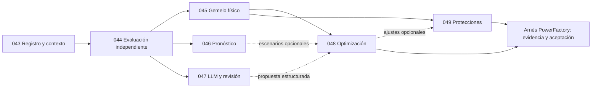

# Mejora integral de IA del conversor — Implementation Plan

> **For agentic workers:** REQUIRED SUB-SKILL: Use `superpowers:executing-plans` para ejecutar una tarea por vez, con casillas y evidencia. No delegar sin autorización del usuario o instrucciones aplicables.

**Goal:** consolidar y evaluar los modelos existentes, cerrar brechas comprobadas e incorporar mejoras de gemelo, pronóstico, asistente, optimización y protecciones mediante specs trazables.

**Architecture:** reutilizar el buffer, el oráculo físico, el intérprete y el arnés nativo actuales. Un registro común gobierna candidatos; evaluación independiente decide promociones; PowerFactory verifica diseños y protecciones. Las propuestas de IA permanecen diferenciadas de los resultados nativos.

**Tech Stack:** Python 3.12, PyTorch/CUDA, Ollama local, React/TypeScript y PowerFactory mediante el arnés existente; adaptadores opcionales evaluables para PyG, NeuralForecast, sentence-transformers, PEFT, pymoo y Pyomo/Ipopt.

**Spec:** paquetes [043](../../../specs/043-consolidacion-y-gobierno-de-modelos/spec.md) a [049](../../../specs/049-protecciones-nativas-y-coordinacion/spec.md), cada uno con `spec.md`, `plan.md` y `tasks.md`. El avance ejecutado y los pendientes reales están en el [registro de ejecución](../../EJECUCION_IA_2026-10-31.md); el estado vigente se conserva en cada spec.

## Global Constraints

- Leer primero `docs/constitution.md`, `.claude/skills/igea-dgs-spec/SKILL.md`, este plan y los tres documentos del paquete a ejecutar. El requisito entra antes que el código.
- Python 3.12 exacto. Una dependencia de aprendizaje opcional no impedirá instalar, arrancar o convertir con el núcleo; los cambios de dependencias del núcleo se mantienen en `requirements.txt`.
- Datos empresariales, incluidos los de contexto/RAG, permanecen en la máquina. No enviar libros, TXT, MDB, VNR-GIS, episodios ni órdenes reales a proveedores externos.
- La selección de red procede del vínculo de fuente y de la lista de alimentadores guardada; nunca se infiere del nombre del proyecto.
- PowerFactory usa un solo carril en serie; trabajos de más de un segundo van a cola con progreso y cancelación. El entrenamiento CUDA usa bloqueo exclusivo; no hay sustitución silenciosa por CPU.
- Mantener fuente exacta `(source_run_id, source_mode, source_fingerprint)`, proyecto, alimentadores, caso nativo, año, periodo, `criterio_fijas`, perfil, versión de red y controles efectivos en cada experimento y caché.
- Preservar datos, `output/`, modelos, historial y parches ajenos. Los planos georreferenciados de IGEA anteriores a la exportación están fuera de alcance por instrucción del usuario.
- Los límites eléctricos salen de la norma/perfil; los umbrales estadísticos de promoción no los sustituyen. Sin datos obligatorios se bloquea, no se inventan ceros, equipos o capacidades.
- No renumerar specs. Al empezar esta revisión ya existían 040–042 de otra sesión; por eso los nuevos paquetes empiezan en 043.

## Review Focus

1. Un proyecto con igual nombre pero otra exportación no comparte modelo/caché: 043 T2, prueba `test_contexto_distinto_no_reutiliza`.
2. Una partición vacía o un holdout usado para calibrar no admite promoción: 044 T1–T2, `test_cuatro_particiones_sin_solape` y `test_sin_calibracion_bloquea`.
3. Una simulación convergente sin métricas completas no valida una alternativa: 044 T3, `test_top_k_sin_metricas_rechaza`.
4. La central existente, sus bancos, el criterio de fijas y las cargas del bloque alteran el contexto físico: 045 T1–T2, `test_controles_y_casos_no_se_mezclan`.
5. Un LLM convincente o un optimizador con buen objetivo no suplen selectividad ni licencia: 047 T3 y 049 T1–T3, `test_critico_sin_evidencia_no_aprueba` y `test_sin_curvas_o_licencia_bloquea`.

## 1. Punto de partida comprobado

Leer la [investigación previa](../../INVESTIGACION_IA_GEMELO_CONVERSOR_2026-10-31.md)
y la [verificación de las publicaciones](../../VERIFICACION_PUBLICACIONES_IA_PF_2026-10-31.md).
La segunda contiene la matriz de cumplimiento, fuentes públicas y el reproductor de
una aceptación con métricas ausentes. No se parte de cero: existen PINN/GNN,
GRU, algoritmos genéticos/NSGA-II/evolución diferencial, BM25, embeddings opcionales,
clasificador, Transformer de órdenes, Ollama y captura de episodios.

En `.worktrees/reentrenamiento-integral/` existen registro de modelos, coordinador,
dataset y QLoRA que no están íntegramente consolidados en la raíz. Se comparan los
archivos, no se copia el árbol completo ni se promueven pesos por su informe histórico.
Las specs 026–027 y las tareas nativas pendientes conservan su estado real.

Las publicaciones aportadas se traducen así: flujo PINN → 044–045; revisión por roles
inspirada en TradingAgents → 047 T3; protecciones PowerFactory → 049. La tercera
publicación no constituye un requisito de PINN dinámico. El flujo algebraico actual
no necesita condiciones iniciales de una ecuación temporal.

## 2. Orden de ejecución y entregables

| Orden | Paquete y plan técnico | Resultado verificable | Dependencia |
| --- | --- | --- | --- |
| P0.0 | [044 T0 Rechazo puntual](../../../specs/044-evaluacion-causal-y-verificacion-completa/plan.md#t0-rechazar-inmediatamente-métricas-ausentes-en-el-auxiliar-actual) | El auxiliar rechaza métricas ausentes/no finitas | Sin contratos nuevos; no cierra la integración de 044 |
| P0.1 | [043 Gobierno y consolidación](../../../specs/043-consolidacion-y-gobierno-de-modelos/plan.md) | Un registro, contexto tipado, runner reanudable y estado visible | Código actual y donante revisados |
| P0.2 | [044 Evaluación y verificación](../../../specs/044-evaluacion-causal-y-verificacion-completa/plan.md) | Cuatro particiones, puertas por familia y verificación completa | 043 y corrección puntual T0 |
| P1 | [045 Gemelo físico PINN/GNN](../../../specs/045-gemelo-fisico-y-contratos-pinn-gnn/plan.md) | Episodios v2, grafo v3, fronteras y controles contrastados | 043 y 044 |
| P2 | [046 Pronóstico temporal](../../../specs/046-pronostico-causal-multihorizonte/plan.md) | GRU sin fuga y comparación NHITS/TFT/PatchTST | 043 y 044 |
| P2 | [047 LLM y PLN](../../../specs/047-asistente-estructurado-y-revision-por-roles/plan.md) | Salidas validadas, RAG evaluado y crítica por roles | 043 y 044 |
| P3 | [048 Optimización evolutiva y PNL](../../../specs/048-optimizacion-mixta-evolutiva-y-pnl/plan.md) | Benchmark comparable y propuestas con aceptación nativa completa | 043–045; 046 solo si se usan escenarios pronosticados |
| P3 | [049 Protecciones](../../../specs/049-protecciones-nativas-y-coordinacion/plan.md) | Disponibilidad real, auditoría de coordinación y reportes | 043–045, datos y licencia; 048 solo para ajustes optimizados |

044 T0 está cerrada con pruebas; la prioridad actual es completar 043 y la
integración de 044 antes de entrenar nuevas
arquitecturas. Las ramas P2 son separables, pero GPU y carril nativo siguen en serie.
No se estima una fecha de entrenamiento o cierre antes de inventariar datos/licencias.

## 3. Contratos compartidos

`043/plan.md` define `ContextoExperimento`, `ExperimentoSpec`, el registro y la CLI.
`044/plan.md` define `Particiones`, `PoliticaEvaluacion` y verificación completa.
Los demás paquetes los consumen; no crean registros, particionadores ni ejecutores
nativos alternativos. Los JSON publicados llevan `schema_version`, hashes de código,
datos, configuración y revisión del modelo.

Los siete identificadores históricos del coordinador se conservan:
`transformer`, `clasificador`, `gru`, `pinn`, `evolutivos`, `embeddings`, `qlora`.
El algoritmo concreto se identifica dentro de `model_manifest.algorithm`, por ejemplo
`patchtst` bajo la etapa temporal `gru`; no introducir una etapa desconocida sin
migración versionada de los informes antiguos.

Los episodios separan «Caso base», «Sin proyecto», «Cargas nuevas» y «Con proyecto»
con identidad nativa y año. «Cargas nuevas» es diagnóstico; no se presenta como obra
aceptada. Se incluyen ampliaciones y deduplicación de 040, distribución/semilla de
041 y etapas/SET nueva de 042 cuando existan en el contexto. Ninguna IA reimplementa
esas reglas ni cambia la central existente para mejorar artificialmente una métrica.

## 4. Evaluación y puertas

- Particiones por custodia y tiempo: entrenamiento, selección, calibración independiente
  y prueba sellada. Agrupar duplicados y escenarios hermanos; evaluar generalización
  entre sistemas aparte del modelo por sistema admitido por 027:RF-68.
- Mantener pisos de 027:RF-53: 30 episodios de entrenamiento, 10 de validación y 10 de
  prueba por sistema. La calibración tiene su mínimo declarado antes de ejecutar en
  `PoliticaEvaluacion`; sin él o sin datos suficientes se bloquea. Estos pisos no son
  una garantía estadística. La curva de aprendizaje decide ampliaciones.
- Mantener las puertas PINN actuales como punto de partida: MAE de tensión ≤ 0,005 pu,
  residuo ≤ 0,05 y razón de error de dorados ≤ 1,05, además de evaluación por familia.
  Predeclarar política de no regresión frente a física y modelo activo por familia;
  no decidir tolerancias mirando el test sellado.
- Pronóstico: comparar con estacional, GRU vigente y modelos candidatos en ventanas
  posteriores; informar MAE, RMSE, pico, pinball, cobertura y latencia por horizonte.
- Asistente: conjunto real separado; tarea ≥ 0,98 y F1 de datos ≥ 0,95 (027:RF-18).
  Menos de 200 órdenes reales conserva la confirmación existente de escrituras;
  200 órdenes sintéticas no sustituyen ese requisito.
- Evolutivos: al menos 20 semillas predeclaradas, igual presupuesto de evaluaciones y
  mismos casos; medir factibilidad, coste, frente/hypervolumen con referencia común,
  tiempo y llamadas nativas. Un óptimo local de Ipopt no prueba óptimo global mixto.
- Aceptación nativa: datos finitos y completos, identidad y unidades, convergencia,
  relectura/reapertura, conservación de controles, norma y comparación con referencia.
  Protecciones añade sensibilidad, tiempo/CTI y poder de corte según datos aplicables.

## 5. Entorno, integración y reversión

La consulta previa detectó una RTX 4060 Laptop de aproximadamente 8 GiB; volver a medir
memoria y compatibilidad al ejecutar. No basta con que el paquete esté instalado.
Probar carga, entrenamiento mínimo y reapertura real con CUDA antes de un entrenamiento
costoso. Fijar revisiones y restricciones de dependencias tras comprobarlas en un entorno
ML aislado; no actualizar por conveniencia el entorno nativo de PowerFactory.

Cada adaptador opcional se importa bajo demanda. Evaluar primero el código actual.
No añadir TimeXer sin aclarar su licencia; PhysicsNeMo, DeepXDE y simulación dinámica
quedan para una decisión posterior sustentada en un experimento necesario.
TradingAgents sirve como referencia de estructura; no se incorpora su motor financiero.

Antes de editar: `git status --short`, `git worktree list`, inspeccionar diffs de los
archivos propios y coordinar su propiedad. En ejecución usar un worktree aislado si
hay cambios de otras sesiones; no hacer `reset`, limpieza de datos ni reemplazo masivo.
Promoción atómica conserva el modelo anterior; restaurar el puntero de registro es
distinto de revertir obras en PowerFactory, que siguen el arnés y sus variaciones.

## 6. Instrucciones para cualquier agente ejecutor

1. Abrir `spec.md`, `plan.md` y `tasks.md` del paquete, además de los contratos de sus
   dependencias. Confirmar las rutas contra el árbol actual: este plan no congela los
   cambios concurrentes de las specs 039–042.
2. Elegir la primera tarea abierta cuyas dependencias estén cumplidas. Crear primero
   la prueba indicada y citar sus RF en docstrings; ejecutar y observar el fallo real.
3. Implementar la interfaz mínima especificada; ejecutar las pruebas de esa tarea y
   las regresiones de los módulos tocados. No usar dobles para cerrar requisitos de
   CUDA, entrenamiento, persistencia o simulación nativa.
4. Guardar informe con comandos, resultado, datos/modelos/revisiones, métricas y
   bloqueos; actualizar el índice si se crea código. Un error de entorno o carencia de
   datos no es una promoción ni una tarea cumplida.
5. Marcar una tarea solo con evidencia. Separar tareas de código y `[DIgSILENT]`.
   Actualizar estado e índices con `python tools/estado_specs.py --escribir`.
6. Cada commit funcional nombra `spec NNN` o `NNN:RF-n`; no incluir archivos de otras
   sesiones. No cerrar 027, 037, 039–042 o aceptación nativa por el avance de este plan.

La validación documental usa `.venv/Scripts/python.exe -m pytest -q
tests/test_trazabilidad_specs.py`. La ejecución completa exige además las suites
afectadas, datos reales requeridos por la constitución y pruebas nativas expresamente
indicadas. No sustituir su ausencia por `skip`, `xfail` o resultados simulados.

## 7. Justificación científica y referencias

La [investigación previa, sección 8](../../INVESTIGACION_IA_GEMELO_CONVERSOR_2026-10-31.md#8-fundamento-académico-consultado)
recoge tesis de maestría (Zhang, UCR, 2024), doctoral (Stiasny, DTU, 2023), PowerFlowNet,
pymoo, TFT y PINN. Los paquetes enlazan las fuentes que justifican sus decisiones.
La [verificación de publicaciones](../../VERIFICACION_PUBLICACIONES_IA_PF_2026-10-31.md#fundamento-y-límites-de-aplicación)
añade doctorado y artículo de protecciones. Ninguna publicación sustituye los datos de
empresa, demuestra que nuestros modelos mejoraron o aprueba una red.

La decisión de introducir un candidato se toma con el benchmark local. Si empata con
la referencia, conservar la solución vigente salvo otra ventaja predeclarada y medida.
Las casillas y el registro de ejecución distinguen código comprobado de trabajo
pendiente; crear el plan no acredita modelos entrenados, promovidos ni aceptados.
